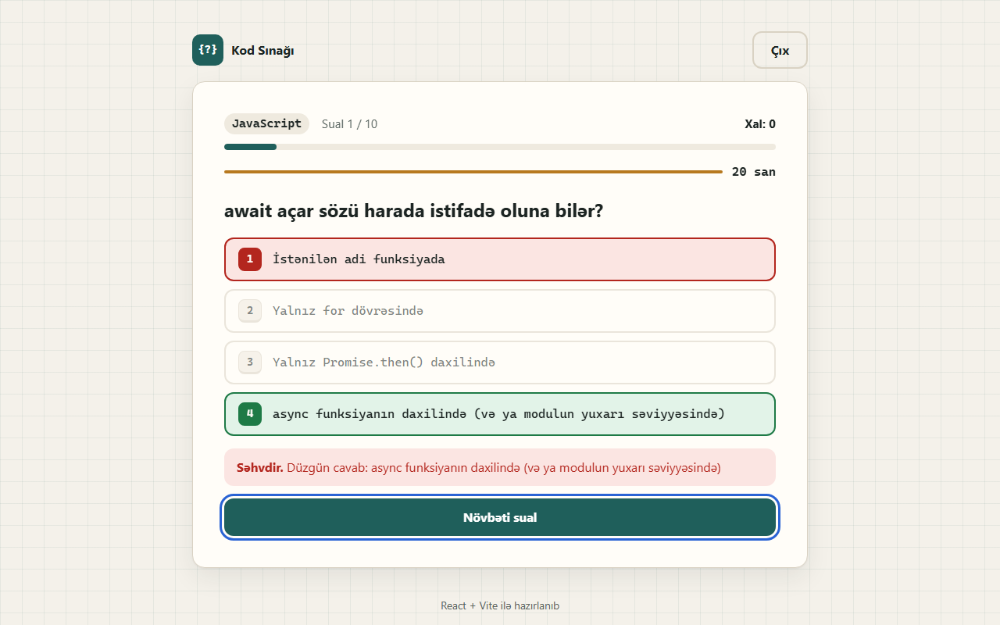

# Kod Sınağı · Code Check

[](https://codelady-ship.github.io/My-Quiz-App/)
[](https://github.com/codelady-ship/My-Quiz-App/actions/workflows/api.yml)
[](https://github.com/codelady-ship/My-Quiz-App/actions/workflows/deploy.yml)

> AZ: HTML, CSS, JavaScript və React üzrə iki dilli (Azərbaycan / İngilis) viktorina — hər raundda 10 təsadüfi sual, taymer, cavabların təhlili və onlayn liderlər cədvəli (Express + MongoDB API). Server əlçatan olmayanda oyun daxili sual bazası ilə işləyir.

A full-stack bilingual (AZ/EN) web-development quiz: a React + Vite frontend on GitHub Pages and a Node.js + Express + MongoDB API (`backend/`, Render) that serves the question bank and keeps an online leaderboard. If the API is not reachable, the quiz uses its bundled question bank and simply hides the leaderboard.




## Features

- Four categories: HTML, CSS, JavaScript and React, with **20 questions each** in Azerbaijani and English.
- 10 random questions per round with shuffled options and a 20-second timer per question.
- Instant correct/wrong feedback, a progress bar and a running score.
- A results screen that reviews your wrong answers and shows the right ones.
- Best score per category saved in the browser (`localStorage`).
- **Online leaderboard** per category: save your score with a nickname and see the top 10 (best score per player). The server re-scores the round from the chosen answers, so a client cannot post a made-up score.
- **Question bank in MongoDB**, editable through admin endpoints (JWT); `src/data/questions.js` is the seed and the offline copy.
- Keyboard friendly (keys 1–4 pick an answer), light/dark theme, respects reduced motion, and works from 360 px phones to wide screens.
- SEO: description, canonical URL, Open Graph/Twitter card, favicon and `sitemap.xml`.

## Tech stack

- **Frontend:** React 19 · Vite · plain CSS (no UI libraries) · Vitest + jsdom
- **Backend:** Node.js 20+ · Express 5 · MongoDB with Mongoose 8 · zod validation · JWT admin auth · CORS allow-list · rate limiting
- **Tests:** Vitest (frontend), `node:test` + supertest + in-memory MongoDB (API)
- **Hosting:** GitHub Pages (frontend, GitHub Actions) · Render free web service (API, `render.yaml`) · MongoDB Atlas free cluster

## REST API

| Method | Path | Access | Description |
|---|---|---|---|
| GET | `/api/health` | public | Status and database connection |
| GET | `/api/questions?category=html` | public | Active questions, same shape as `src/data/questions.js` |
| GET | `/api/leaderboard/:category` | public | Top 10, best score per nickname |
| GET | `/api/stats` | public | Plays, average and best score per category |
| POST | `/api/scores` | public (rate limited) | `{ nickname, category, lang, answers: [{ id, answer }] }` → `201 { score, total, rank, leaderboard }` |
| POST | `/api/auth/login` | public (rate limited) | `{ email, password }` → `{ token }` |
| GET / POST | `/api/admin/questions` | admin | List / add questions |
| PUT / PATCH / DELETE | `/api/admin/questions/:qid` | admin | Replace, enable/disable (`{ active }`), delete |
| DELETE | `/api/admin/scores/:nickname` | admin | Remove a player's scores (moderation) |

Admin calls need `Authorization: Bearer <token>`.

## Run locally

```bash
npm install
npm run dev          # local dev server
npm test             # vitest unit tests (shuffle, scoring, best score, question bank)
npm run build        # production build to dist/
npm run build:pages  # build with base /My-Quiz-App/ for GitHub Pages
```

API (needs MongoDB: a free Atlas cluster or a local `mongod`):

```bash
cd backend
cp .env.example .env   # fill MONGODB_URI, JWT_SECRET, ADMIN_EMAIL, ADMIN_PASSWORD
npm install
npm run dev            # http://localhost:4000, an empty bank is seeded from src/data/questions.js
npm test               # API tests on an in-memory MongoDB
```

Then open the frontend with `?api=http://localhost:4000` (honoured only when the page runs on `localhost`/`127.0.0.1`; for example `http://localhost:5173/?api=http://localhost:4000`), or start it with `VITE_API_URL=http://localhost:4000 npm run dev`.

## Deployment

`.github/workflows/deploy.yml` runs on every push to `main` (and on demand). It runs `npm ci`, then `npm test`, then `npm run build:pages`, and deploys `dist/` to GitHub Pages with `actions/deploy-pages`. If a test fails, nothing is deployed. The build reads the repository variable `VITE_API_URL` (Settings → Secrets and variables → Actions → Variables); without it the site runs on the bundled questions only.

`.github/workflows/api.yml` runs the API tests on pushes and pull requests that touch `backend/` or the question bank.

**API on Render:** create a free MongoDB Atlas M0 cluster (allow `0.0.0.0/0`), then on Render choose *New → Blueprint* and pick this repo. `render.yaml` creates the free web service `my-quiz-app-api` from `backend/`; fill `MONGODB_URI`, `ADMIN_EMAIL` and `ADMIN_PASSWORD` (`JWT_SECRET` is generated). The first start seeds the questions. Finally set `VITE_API_URL` to the Render URL and re-run the Pages workflow. The free service sleeps after 15 idle minutes, so the first visit may use the offline bank.

Live: <https://codelady-ship.github.io/My-Quiz-App/>

## What I learned

- Building a REST API with Express and Mongoose, and scoring on the server so the leaderboard cannot be faked with a simple request.
- A MongoDB aggregation pipeline for "best score per player" leaderboards.
- Keeping the static site working when the API sleeps: an 8 s timeout and a bundled fallback.

- Keeping quiz logic (shuffle, scoring, best score) in pure functions in `logic.js` makes it easy to unit-test without a browser.
- Storing every question once with `az` and `en` text and a single answer index keeps the two languages in sync.
- A React timer needs careful cleanup in `useEffect` so it resets correctly when the question changes.
- Vite's `base` option and a `404.html` redirect are needed for a single-page app under a GitHub Pages sub-path.
- A CI workflow that runs the tests before building stops a broken version from going live.
- Accessibility details matter: focus moves to each new question, the timer has an ARIA label and answers work from the keyboard.
