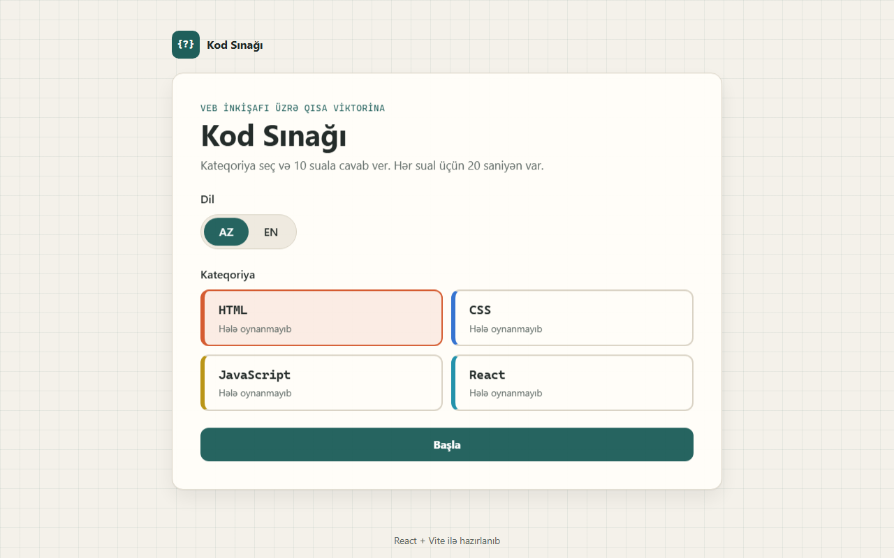

# Kod Sınağı · Code Check

[](https://codelady-ship.github.io/My-Quiz-App/)
[](https://github.com/codelady-ship/My-Quiz-App/actions/workflows/deploy.yml)

> AZ: HTML, CSS, JavaScript və React üzrə iki dilli (Azərbaycan / İngilis) viktorina — hər raundda 10 təsadüfi sual, taymer və cavabların təhlili.

A bilingual (AZ/EN) web-development quiz built with React and Vite.




## Features

- Four categories: HTML, CSS, JavaScript and React, with **20 questions each** in Azerbaijani and English.
- 10 random questions per round with shuffled options and a 20-second timer per question.
- Instant correct/wrong feedback, a progress bar and a running score.
- A results screen that reviews your wrong answers and shows the right ones.
- Best score per category saved in the browser (`localStorage`).
- Keyboard friendly (keys 1–4 pick an answer), light/dark theme, respects reduced motion, and works from 360 px phones to wide screens.
- SEO: description, canonical URL, Open Graph/Twitter card, favicon and `sitemap.xml`.

## Tech stack

React 19 · Vite · plain CSS (no UI libraries) · Vitest + jsdom for tests · GitHub Actions + GitHub Pages

## Run locally

```bash
npm install
npm run dev          # local dev server
npm test             # vitest unit tests (shuffle, scoring, best score, question bank)
npm run build        # production build to dist/
npm run build:pages  # build with base /My-Quiz-App/ for GitHub Pages
```

## Deployment

`.github/workflows/deploy.yml` runs on every push to `main` (and on demand). It runs `npm ci`, then `npm test`, then `npm run build:pages`, and deploys `dist/` to GitHub Pages with `actions/deploy-pages`. If a test fails, nothing is deployed.

Live: <https://codelady-ship.github.io/My-Quiz-App/>

## What I learned

- Keeping quiz logic (shuffle, scoring, best score) in pure functions in `logic.js` makes it easy to unit-test without a browser.
- Storing every question once with `az` and `en` text and a single answer index keeps the two languages in sync.
- A React timer needs careful cleanup in `useEffect` so it resets correctly when the question changes.
- Vite's `base` option and a `404.html` redirect are needed for a single-page app under a GitHub Pages sub-path.
- A CI workflow that runs the tests before building stops a broken version from going live.
- Accessibility details matter: focus moves to each new question, the timer has an ARIA label and answers work from the keyboard.
